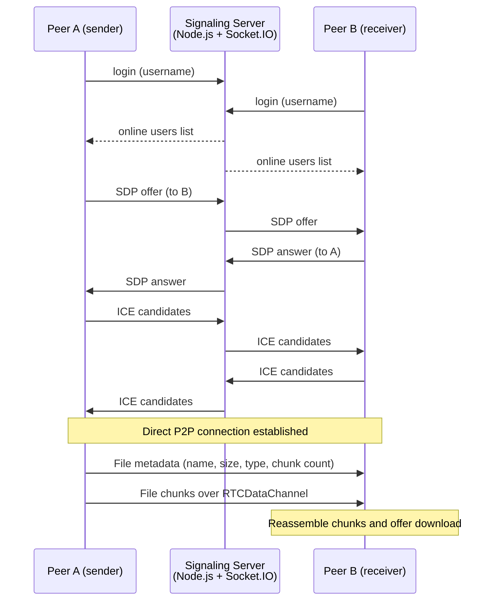

# WebRTC P2P File Transfer

Browser-to-browser file transfer over **WebRTC data channels**. A lightweight Node.js signaling server helps two peers find each other and set up the connection. After that, files flow directly between the browsers without passing through any server.

**Stack:** JavaScript, WebRTC, Node.js, Express, Socket.IO, HTTPS, jQuery, Bootstrap

## Features

- **Peer-to-peer transfer:** file data goes directly between browsers over an `RTCDataChannel`
- **Chunked transfer:** files are split into 100 KB chunks, sent in order and reassembled on the receiver
- **Flow control:** the sender pauses when the data channel buffer passes 10 MB, so large files don't overflow it
- **Signaling server** over HTTPS and Socket.IO that tracks online users and relays connection setup messages
- **NAT traversal** using a public STUN server
- **Live progress and stats:** chunk progress, transfer time and throughput (KB/s) for both sender and receiver
- **Web interface:** pick a user from the online list, connect, choose a file and download it on the other side

## How It Works

The system has two parts: a **signaling channel** for setting up the connection, and a **data channel** for the transfer itself.



### Signaling server (`server/filetransfer-server.js`)

1. A client connects and signs in with a username.
2. The server stores the username and socket ID and broadcasts the updated list of online users.
3. The server relays SDP offers, answers and ICE candidates to the target peer by username.
4. When a client disconnects, it is removed and the user list is updated.

### Data channel (`js/filetransfer.js`)

1. Each peer creates an `RTCPeerConnection` with a STUN server and opens a data channel for sending.
2. The sender first sends the file's metadata as JSON, then reads the file in 100 KB chunks with `FileReader` and sends each one.
3. Before each chunk, the sender checks the channel's `bufferedAmount` and waits if the buffer is too full.
4. The receiver collects the chunks, and once all bytes have arrived it builds a `Blob` and shows a download link.

## Getting Started

### Prerequisites

- Node.js and npm
- Two devices (or two browser windows) on the same network

### Setup

1. Install the server dependencies:

   ```bash
   cd server
   npm install
   ```

2. Set the server address in `js/filetransfer.js` to your machine's IP:

   ```js
   let host = 'https://YOUR_SERVER_IP:3000'
   ```

3. Start the signaling server:

   ```bash
   node filetransfer-server.js
   ```

4. On each device, open `https://YOUR_SERVER_IP:3000/filetransfer.html`. The server uses a self-signed certificate, so accept the browser's security warning.

### Usage

1. Enter a username and click **Connect To Server**.
2. Select another online user and click **Connect To Peer**.
3. Choose a file and click **Send**.
4. On the receiving side, click the download link when the transfer completes.

If the peers can't connect, check that the local firewall allows traffic on port 3000.

## Project Structure

```
├── filetransfer.html            # Web interface
├── js/
│   └── filetransfer.js          # WebRTC peer connection, chunking and file transfer
├── server/
│   ├── filetransfer-server.js   # Signaling server (Express + Socket.IO over HTTPS)
│   └── cert/                    # Self-signed TLS certificate for local development
└── Problem.pdf                  # Original project description
```

The full project description is in [Problem.pdf](Problem.pdf).
